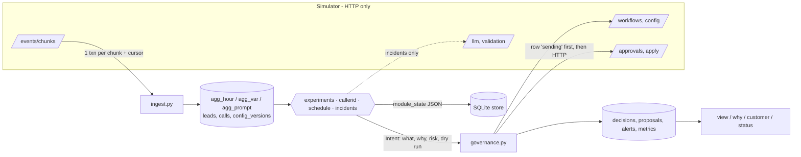

# Outcome-First Agent Loop — Submission

**Name:** _fill in_ · **Date:** 2026-11-07 · **Hours actually spent (be honest):** _fill in_ · **Language / storage:** Python 3.12, SQLite (WAL), stdlib + `httpx`

How to run, debug and extend it: [docs/CONTROLLER.md](docs/CONTROLLER.md). Every number below comes from files in `reports/`.

---

## 0. TL;DR
- The controller is one Python process that drives the simulator over HTTP. It ingests every chunk idempotently and makes decisions in four modules: variant tests, caller-ID health, call-time weights and hallucination incidents. All of them go through a single governance gate, and every decision is written to an auditable SQLite store.
- **public_01:** conclusions **+13.7%** vs baseline (pickup +10.8%, engagement +1.3%), 17 changes, **0 harmful**.
- **public_02:** conclusions **+30.2%**, 19 changes, **0 harmful**. Flagged caller ID: 10.7% of dials on the day it was flagged, 0% from the next day on. Bad supervisor prompt fixed in **135 min**, spending 4 credits.
- **public_03_load:** +22.5%, 49 changes, 0 harmful. About **20 s wall per sim day** including the simulator's own time. 6 SIGKILLs mid-run: every invariant holds.
- **Deliberately not built:** per-person call time, proactive prompt optimisation, cross-tenant fairness (C15), and a UI (the supervisor view is a CLI).

## 1. Assumptions
1. `*_max_drop: 0.02` guardrails are read as **relative** (2% of the rate). That is the stricter reading. Where the absolute reading (2 points) changes a conclusion, I say so (§11).
2. `max_shift` limits each auto-applied change. Stepping toward a target with several auto changes is allowed, but **only for risk-reducing moves**, and at most one step per hour (one per 15 min for safety moves).
3. Caller ID and call timing are operational settings, as the policies' `allowed_dims` imply. Welcome message, voice and prompt are customer-facing.
4. A supervisor edit expresses intent. We adopt it as the new incumbent and leave that dimension alone for 72 h. Safety fixes still go to the approver.
5. Client preferences stricter than the policy are honoured (`controller/preferences.json`). Looser ones are not.
6. The pre-D0 history ran on the business default config, so it holds no information about variants. It is used for baselines, hour shapes, per-number history and known-good prompts.
7. Hidden scenarios share the API and schema. Workflow IDs may differ, so nothing is keyed on public IDs except the one client preference.
8. `lead_id` has the form `<wf>:l<int>`. This is used for compact lead indexing; anything that doesn't match falls back gracefully.
9. Credits are worth more than they cost here (CTO memo). Spend only where a credit changes a decision.
10. The approver only sees what we send. A request is something a busy person reads, so the summary is one line and the details are structured.

## 2. Scope decisions
| # | Capability | Built / Partial / Cut | Why | What it would take to finish |
|---|---|---|---|---|
| C1 | Ingestion at load scale | **Built** | Everything else depends on fresh, exactly-once data | Push-based feed, see §8 |
| C2 | Shared cohort object | **Built** | One `Cohort` (id derived from its where-clause) is used in config, analysis, view and audit | — |
| C3 | Bootstrap from history | **Built** | Free evidence: baselines, hour shapes, per-number history, known-good prompts | — |
| C4 | Call-time optimisation | **Partial**: per cohort | Per person means acting on 1–3 calls, which breaks constraint 5 | A per-person model with pooled priors and a holdout |
| C5 | Caller-ID health | **Built** | Biggest pickup lever, and an incident type | Re-probing quarantined numbers |
| C6 | Welcome/voice experiments | **Built** | The primary KPI for engagement workflows | Adaptive allocation; per-cohort targeting beyond carve-outs |
| C7 | Promotion, decay, rollback | **Built** | Decaying winners are a graded failure mode | More holdout power (§13) |
| C8 | Hallucination response | **Built** | Customer harm and a compliance incident | The LLM branch is unit-level only (public scenarios always have a known-good prompt) |
| C9 | Governance client | **Built** | The non-negotiable boundary | Approver-side withdrawal API |
| C10 | Impact, affected leads, dry runs | **Partial** | Dry runs are honest replays. The impact score is a documented mapping, not calibrated | Calibrate impact against realised lift |
| C11 | Supervisor view | **Partial**: CLI markdown | One screen exists; a UI adds nothing to the evaluation | Serve the same markdown over HTTP |
| C12 | Audit store | **Built** | Floor requirement, and the live review | — |
| C13 | Crash recovery, demonstrated | **Built** | SRE non-negotiable | — |
| C14 | Loop observability | **Partial** | Metrics table, `status`, de-duplicated alerts with runbooks; no pager integration | Export to Prometheus / alertmanager |
| C15 | Cross-tenant fairness | **Cut** | Per-workflow budgets and a global credit reserve already stop starvation at this size | Weighted fair queue over credits and approver slots |

**Principle:** first the things that can't be wrong (governance, audit, crash safety, ingestion). Then the levers with the biggest outcome per unit of risk (caller-ID spreading, incident response). Then the statistically demanding one (experiments), done properly rather than broadly. Anything that needs per-person inference or a new piece of infrastructure was cut.

## 3. Stakeholders

### 01 — Nikhil Rao, Sales
- **Accepted:** speed where it is safe. Risk-reducing moves (dropping losers, rollbacks, caller-ID rotation) are applied automatically within policy. A per-client lift number is in the supervisor view and the reports, as pickup and engagement **separately**.
- **Declined:**
  - A single blended score (Product definition, constraint 3).
  - "Live for everyone by evening": a winner needs ≥ 20 live hours and z ≥ 3; the simulation says a lunchtime winner is about 20% likely to be noise.
  - Rolling out the "persuasive" prompt: there is no validation evidence, and its catalogue summary alone ("freer objection handling") is a hallucination risk.
- **Wrong against policy:**
  - "Kestrel turned on auto-apply for everything" is false. `ks_cancel` allows `schedule, caller_id, welcome_message, voice` with `max_shift: 0.2`. Prompts and cohorts need approval.
  - "Northwind is fine with auto-apply on KYC" is false. `nw_kyc` has `auto_apply.enabled: false`, and Northwind's compliance head requires named human approval.
- **Reply:** "Nikhil — happy to give you real numbers for the summit: per client, pickup and conclusion rate vs the untouched baseline (e.g. +30% conclusions on the incident scenario). I won't blend them into one score. Product and our regulated clients have ruled that out, and it would be the first question a BFSI audience asks. Two corrections: Kestrel's auto-apply covers caller ID, timing, voice and welcome in small steps, not prompts; Northwind KYC has no auto-apply at all. "Winning by lunch" is noise about one time in five, so we promote after a full day of evidence. The persuasive prompt hasn't passed validation; I won't ship it."

### 02 — Meera Iyer, Compliance, Northwind
- **Accepted:**
  - Every customer-facing change (welcome, voice, prompt) on Northwind goes through a named approval. That is enforced in code (`governance._auto_dims`) regardless of what a policy permits: risk-increasing customer-facing moves are never auto-applied anywhere.
  - Prompt changes always carry a validation run id.
  - Requests are only sent in approver hours, and only if a median-latency decision lands the same day.
  - Per-customer answers: `controller customer --lead <id>` lists every call, the variant heard, the config version, and who approved it and why.
  - Changes that hurt a cohort are guarded by segment carve-outs at promotion and by dropping losers early.
- **Pushed back:** "slow and right" is honoured, but exploration does put 15% of traffic per challenger on untested variants. The downside is bounded and stated in every request.
- **Wrong:** "operational settings are covered by the policy we signed" holds for renewal only. On KYC, auto-apply is disabled, so even caller-ID changes go to your approvers.
- **Reply:** "Meera — confirmed: nothing a customer hears changes on Northwind without a named approval, and script changes carry a validation run. For IRDAI, we can answer 'what did customer X hear on day D and why' from our own records in seconds, down to variant, config version, approver and rationale. One correction: on KYC your policy doesn't permit any automatic change, so caller-ID and timing changes there also come to your approvers (10:00–18:00, never at night). For renewal, the weekly summary lists every operational change and its reason."

### 03 — Kabir Menon, Platform & SRE
- **Accepted:**
  - A kill/restart test exists: `scripts/crash_test.sh` does 6 SIGKILLs and every invariant passes (`reports/crash_recovery_public_02_incidents.txt`).
  - Idempotency keys are written before every call.
  - Paging is limited to alerts that need a human now, each with a runbook line.
  - Loop health is visible without reading logs (`controller status`, `metrics` table).
  - Measured: **~20 s per load-scenario day**, against your 10-minute bar.
- **Pushed back:** I used SQLite rather than your Postgres. It is an embedded file, not a new stateful service: nobody operates it at 2 a.m. It has the same schema, so moving to Postgres is mechanical, and I'd move when we run more than one controller process (§8).
- **Reply:** "Kabir — kill -9 at any point is tested (6 random kills, no double applies, no lost approvals, exactly-once ingestion, checked against the simulator's own logs). Load: ~20 s per simulated day of public_03 on one core, peak 1.05 GB. State is one SQLite file next to the process: no new service to run. When we shard per tenant I'll move to the existing Postgres. Pages are only for open hallucination incidents, ingest lag, credits and controller errors; each says what to look at."

### 04 — Anita Desai, Operations Supervisor, Kestrel
- **Accepted:**
  - At most 2 requests a day, none before 11:00 (`preferences.json`), batched into one request.
  - Her prompt edits are never reverted silently.
  - One screen (`controller view`).
  - Hallucination fixes prefer prompts with proven engagement on her own traffic, and a fix that is safe but lowers engagement raises an alert, so the "verbatim script" failure is caught.
- **Pushed back:**
  - When her prompt hallucinated (public_02: P2), we did not leave it running. We sent an approval with evidence; the approver decides.
  - Urgent incident fixes may go out at 10:00 rather than wait for 11:00.
  - Risk-reducing changes (rotating a flagged number, dropping a losing voice) are applied within policy and shown on the screen, not announced in advance.
- **Wrong:** none against policy. Her limits are stricter than the policy's (4 requests, 10:00 start), so we adopt them.
- **Reply:** "Anita — your screen shows what's being tested, what's winning, what we need from you and what changed today. You'll get at most two requests a day, after 11:00, each bundling everything. We never undo your edits. When your D3 script started hallucinating at 4× the normal rate, we sent you a request to go back to P1, with the evidence, rather than switching it ourselves. Safety-reducing changes (pulling a spam-flagged number) happen immediately and appear on the screen."

### 05 — Tara Kulkarni, Product
- **Accepted:**
  - Separate KPIs everywhere.
  - One cohort object.
  - An explicit minimum sample and window: ≥ 300 connected calls per arm, ≥ 20 live hours, z ≥ 3. Cost: a true +10% arm wins in about 3 dialling days, 64–77% of the time within the 6-day window. False winners run at about 2–3% per dimension (§5).
  - Every proposal carries impact, diff, affected leads and a dry run.
  - Expired proposals are re-planned from fresh data, never resubmitted.
  - Learning uses only variants that were actually served.
  - Winners stay inside their own workflow.
- **Declined:** per-person call time as the summit headline (§5); a consolidated *UI* (a CLI view instead). Caller-ID health is built.
- **Wrong:** "an expired proposal is a rejection". In the API it is a distinct status (`expired`), and the cause differs: the approver never saw it in time. Operationally we treat it the same (cooldown, re-plan), but we record it separately, because it is a timing failure on our side.
- **Reply:** "Tara — all definitions held. Minimum evidence is 300 connected calls per arm over ≥ 20 live hours at z ≥ 3. That buys roughly a 2–3% false-winner rate per tested dimension, at the cost of ~3 days to detect a true +10% effect; the simulation script is in the repo. The impact score is the expected relative lift on the primary KPI ÷ 10% (incidents and rollbacks get fixed bands), so ranking by it is meaningful but not yet calibrated. I cut per-person call time: one past connect is an anecdote. Per-cohort timing ships instead."

### 06 — Aryamann, CTO
- **Accepted:**
  - Credits are spent only where they change a decision. public_02 used 4 credits of 200: one watch validation, one fix validation, zero LLM calls, because a known-good prompt existed.
  - Scale numbers and the breaking point are in §8.
  - A runbook exists for the on-call engineer.
  - Cut list with reasons (§2).
- **Wrong claims found:** listed under 01, 02 and 05.
- **Reply:** "Aryamann — five things done properly: governance, the experiment loop with decay rollback, caller-ID health, incident response and the audit trail. Plus crash safety and load numbers. I said no to per-person call time, cross-tenant fairness and proactive prompt changes; the reasons are in §2 and §13. The first thing to break at 10× is single-process ingestion plus the raw call table on one SQLite writer, not decision logic. The partitioning plan is §8."

## 4. Architecture



Each tick: `state` → ingest every new chunk → reconcile our open proposals with `GET /approvals` → handle supervisor edits → modules observe → apply approved proposals → plan (auto or approval) → `advance 15 min` (night hours are skipped in one call). **All state lives in one SQLite file.** On restart the same order runs again from the store. Nothing important is held only in memory: the lead index is rebuilt from the `leads` table in under 1 s.

## 5. The learning loop
- **Cohorts.**
  - One `Cohort(id, where)`, with the id derived from the where-clause (`fc_age_60p`), so detection, experiments, the schedule, the view and the config all refer to the same object.
  - The schedule picks its partition (age, tier, age×tier, lang, …; ≤ 12 cohorts) by out-of-sample dry-run gain. On public scenarios that was age band: 4 cohorts, about 900 dials per cohort per day on renewal.
  - Experiments run on the whole population and are analysed per served cohort stratum. Splitting tests by cohort would fragment traffic: a 15% arm in a 20% segment yields ~30 connects a day, too few to decide anything inside a 10-day run.
  - Segments are used only for **harm checks** (carve-outs). Minimum 100 connected calls before a segment can veto.
- **Experiment design.**
  - Each challenger gets 15% of traffic (incumbent ≥ 55%).
  - Welcome × voice is factorial for free, because the simulator samples dimensions independently per dial, so each dimension's marginal comparison is unbiased. Interactions are assumed multiplicative and not modelled (§13).
  - Exploration is approved by a human. Dropping arms is automatic where policy allows.
- **Deciding a winner.**
  - Mantel-Haenszel risk difference, stratified by (day, 3 h block, served cohort), so incidents and allocation changes don't bias it.
  - Promote when: z ≥ 3.0, ≥ 300 connects, ≥ 20 h live, last-24h lift ≥ ⅓ of the cumulative lift (not fading), and the guardrail is not breached.
  - Drop an arm when z ≤ −2.0 with ≥ 150 connects, or (daily check) when it was clearly good earlier and is negative over 48 h.
  - Multiple comparisons are handled by the z = 3 bar, which covers up to 3 challengers per dimension under hourly peeking.
  - `scripts/false_winner_sim.py`, using the real peeking schedule, gives a **false-winner rate of 1.9% per dimension per scenario at 90 connects/h and 3.0% at 110/h**. Power for a true +10% arm is 64–77% (median ~3 dialling days), for +15% 97–99% (~2 days). A null arm is dropped 11% of the time; that only loses an option.
- **Decay and rollback.**
  - After promotion: 85% winner, 15% old incumbent as a permanent control.
  - Hourly, with ≥ 24 h of post-promotion data, roll back if any of these holds:
    - the last 24 h are clearly worse (z ≤ −2.33);
    - the lift fell significantly from its post-promotion reference and less than ¼ remains;
    - all post-promotion data is significantly worse, or has lost most of the shrunk promotion lift.
  - The reference is post-promotion data, never the promotion estimate itself, because of the **winner's curse**. Before this fix, a real +9% winner on public_01 was "detected as decayed" and rolled back, harmfully.
  - Measured: public_02's decaying W3 (promoted while still +19%) held 59/85/86/53/0% of in-population calls on days 2–6. The rollback fired on D5 08:00, about 3 days after onset; one judgement-call rejection delayed it further. This is power-limited by the 15% control (§13).
- **Call time and caller ID.**
  - Call time uses history directly: hour shape per cohort, shrunk with 150 pseudo-dials, weights = (cohort shape ÷ population shape)^γ, normalised so no cohort is systematically favoured. The 2-fold out-of-sample dry run holds hourly capacity and per-cohort volume fixed (Sinkhorn), and predicts engagement as well as pickup.
  - Caller ID: volume is spread evenly over healthy numbers. Unknown numbers are probed at 10% (20% where every step costs an approval) and graduate after 250 dials at ≥ 85% of the others' pickup.
  - Quarantine requires pickup < 70% of the other numbers (z ≤ −3) **and** < 80% of the number's own recent history. Without the second condition, KYC's sole number was quarantined just for carrying all the volume.
- **Guardrail.**
  - Every promotion checks the arm's pickup (dials are randomised too).
  - Schedule fits must predict an engagement change within half the guardrail (pickup-primary workflows) or ≥ −0.2% (engagement-primary).
  - A workflow-level drift monitor raises an alert.

## 6. Governance
- **State machine:**
  - `sending → pending → approved → applied`
  - `approved → stale` (409: re-planned on the new base) / `lapsed` (410) / `withdrawn` (a later safety decision overrode it)
  - `pending → rejected | expired` (6 h cooldown for routine requests, then re-planned with fresh data and a new id)
  - Auto path: `sending → applied | refused` (403: that dimension is routed to approval for 24 h)
  - `sending` rows are reconciled against the server by `proposal_id` after a crash.
- **Batching and timing:**
  - One routine request in flight per workflow, carrying everything that changed. An incident fix may go alongside it; a routine approval is held until 30 min before its apply-by, so the fix lands first.
  - Budget = min(policy, client preference), with one slot reserved for incidents and rollbacks.
  - Routine requests are sent only if a median-latency decision lands inside today's approver hours. Urgent ones are sent only if a worst-case decision lands before expiry.
  - Result: no lapses, no fatigue rejections, no expiries on public_01/02 (`reports/`).
- **Auto-apply:**
  - Used for caller ID, schedule refreshes and risk-reducing customer-facing moves. The check: no new arm, and only the safe arm gains share, verified against the live config.
  - Voluntarily never used for: starting tests, promotions, prompts, or any dimension a supervisor touched in the last 72 h.
- **Impact, affected leads, dry run:**
  - `affected_leads` = leads still being worked (campaign inside its cadence, not concluded) that the change reaches.
  - Dry runs replay observed calls per arm actually served (experiments), the out-of-sample schedule replay, or per-number pickup (caller ID).
  - Impact = expected relative lift on the primary KPI ÷ 10%. Fixed bands: exploration 0.08, risk reduction 0.6, quarantine 0.7, incidents 0.5 + excess hallucination rate ÷ 4%.
  - These are honest point estimates. Calibration is §14.
- **Supervisor edit mid-experiment (public_02 D5 15:00, voice → V2):**
  1. The test was stopped and V2 adopted as incumbent, with voice pinned for 72 h.
  2. Our approved welcome-test request went stale and was re-proposed the next morning on the new base.
  3. After the pin expired, V1 was re-tested *against* V2, via approval.

## 7. Incidents
- **Hallucination detection:**
  - Exact binomial test on the current prompt's QA flags over 4 h, vs 1.2× the historical baseline (which already includes the detector's ~1% false positives).
  - Normal bar: p < 0.001, rate ≥ 2× baseline, ≥ 150 connects. False-positive rate per window < 0.1% (`tests/test_controller.py`).
  - When someone else changes the prompt, we spend one validation run (2 credits) at once. If it fails, the bar drops to p < 0.01 (p < 0.05 and 1.5× if it failed by more than a point): two independent signals.
- **Choosing a fix:** first a prompt this workflow has actually run with a normal flag rate (it has observed safety *and* engagement); otherwise ask the LLM (3 credits). Every candidate gets exactly one validation run, with no re-rolls. Incident spend is capped at 14 credits, with a global reserve of 10.
- **Verifying:** after ≥ 150 connects on the fix, flags must be back under threshold. An engagement drop vs before the incident raises an alert.
- **public_02 timeline (ks_cancel):**

| sim time | event |
|---|---|
| D2 10:00 | (hidden) caller ID D2 flagged |
| D2 12:30 | D2 quarantined: 18.3% vs 27.3% pickup, z=−4.7, 0.73× its own history. Auto-rotated in two steps (max_shift 0.2) |
| D3 11:30 | supervisor ships P2 |
| D3 11:45 | watch validation of P2: pass 0.935 < 0.97 |
| D3 12:15 | incident opened: 6/102 flags = 5.9% vs 1.5% |
| D3 12:15 | P1 (20k connects observed on this workflow) validated at 0.990; approval sent |
| D3 13:45 | approved and applied (MTTR 135 min from the edit) |
| D3 15:30 | verified: 1.91% on 157 calls; resolved |

Hallucinated calls on ks_cancel: **95 vs 348** baseline.

## 8. Scale
Measured on public_03_load (`reports/load_test.md`, Apple M-series, one core used):

| | value |
|---|---|
| ingest | **160–240k events/s** (history 6.4M events in 27 s; 840k events per sim day in ~5 s) |
| decide | 6–10 s per sim day across 12 workflows; **max decision lag per tick ~1.1 s** steady state |
| wall per sim day (incl. simulator generation) | **16–20 s** (SRE target: 600 s) |
| total (7 history days + 5 days) | 108 s |
| peak RSS | 1.05 GB (history chunk parsing); store 304 MB including 3.24M raw call rows |

**At 10×** (≈8.4M events/day, ~120 workflows):
- Ingest needs about 50 s per sim day on one core: fine.
- Decide time grows with workflows × days of aggregates, roughly 100 s per day: fine, but it grows linearly with retention.
- **What breaks first:**
  1. The single-writer SQLite file with raw call rows: ~30M rows per 5 days, and the writes contend with decision reads.
  2. The one-process sequential loop: a single slow workflow delays all of them (we saw one 70 s OS I/O stall).
- **The fix:**
  - Partition by **workflow**. Every module's state and aggregates are per workflow already; the only cross-workflow resources are credits and tenant-level approver budgets.
  - Run N workers, each owning a hash range of workflow ids, on the existing Postgres: aggregates partitioned by (wf, day), with the raw call log in an append-only partitioned table or object storage.
  - Ingestion becomes a consumer group on the event stream, committing offsets with aggregates in the same transaction (the same pattern as today's chunk cursor).
  - Credits become a per-tenant token bucket in Redis.

## 9. Reliability
- **Crash test** (`scripts/crash_test.sh`, output in `reports/crash_recovery_public_02_incidents.txt`):
  - Method: 6 SIGKILLs at random 1–4 s intervals, landing in history ingest, mid-day decisions and mid-HTTP calls. Then a restart that runs to completion.
  - Checks against the simulator's own logs:
    - every event ingested exactly once (324,314 = last_event_id; 104,000 calls = 104,000);
    - no approval applied twice, no auto proposal id reused;
    - no lapses;
    - every server approval is in our store with a consistent status.
  - Outcome: conclusions +31.8%, matching uninterrupted runs.
- **What's lost on a crash:** at most one validation or LLM result whose response didn't arrive. There is no GET endpoint to recover it, so it is re-spent (~2 credits). Nothing else.
- **Idempotency keys:**
  - Chunk number: the cursor is committed with the aggregates.
  - `event_id`: primary key on raw calls.
  - `proposal_id` (`<wf>-<kind>-<n>`): row written as `sending` before the POST or PUT; reconciled by id.
  - A second apply returns `not_approved/applied` and is treated as done.
- **4xx/5xx handling:**
  - GETs retry with backoff.
  - Writes never retry blindly. `advance` reads the clock back after a transport error.
  - 409 stale → re-plan. 410 → lapsed + alert. 403 → route to approval. 402 → incident alert. 422 or a fixable rejection → ticket (our bug).
  - One workflow's exception freezes only that workflow and pages.

## 10. Audit & observability
`python -m controller why --workflow ks_cancel --at "D3 15:00"` (real output, trimmed):
```
## ks_cancel at D3 15:00: config v8
- set by controller_approved at D3 13:45; dims changed: ['prompt_version']
- approval apr_00007 (proposal ks_cancel-incident-0006); requested D3 12:15 via approval (incident)
- summary: fix hallucinations: prompt P2 -> P1 (validated 99.0%)
- rationale: Prompt P2 is producing hallucination flags at 5.88% vs 1.52% baseline (6/102 connected calls,
  p=1.1e-02). P1 is observed on this workflow's own traffic (20509 connected calls, flag rate 1.52%,
  engagement 50.0%) and passed validation at 0.990.
- impact score 1.0, affected leads 3595 · evidence: {"validation_run_id": "val_00002"}
### Decisions that led here
- D3 11:45 [supervisor_edit] supervisor changed ['prompt_version'] (v7). Respected: no automatic revert …
- D3 11:45 [incident_watch] prompt changed P1 -> P2 by supervisor; validation pass rate 0.935 (BELOW 0.97 …)
- D3 12:15 [incident_open] hallucination flags on prompt P2: 6/102 = 5.88% …
### What happened next
- 24h before: pickup 0.271, engagement 0.497, halluc flags 0.0215 · 24h after: pickup 0.252, engagement 0.507, flags 0.0165
- next change: v9 by controller_auto at D6 08:00 ['welcome_message', 'voice']
- D3 15:30 [incident_resolved] flag rate back to 1.91% on 157 calls (baseline 1.52%)
```
- **Also available:** `controller customer --lead <id>` (what a person heard, per call, and why), `decisions`, `view` and `status`.
- **Page on:** open hallucination incident; no validated fix; credits below the reserve; ingest lag > 0 after a tick; a workflow step raising.
- **Don't page on (ticket or view instead):** quarantines, KPI drift, judgement rejections, stale applies after supervisor edits, experiment decisions.

## 11. Results

**public_01** (`reports/public_01.md`): 17 changes applied: 9 beneficial, 8 neutral, **0 harmful**. 11 requests; 10 approved, 1 judgement rejection, 0 expired or lapsed.

| workflow | conclusion rate | Δ | pickup | Δ | engagement | Δ |
|---|---|---|---|---|---|---|
| ks_cancel | 0.378 | +10.5% | 0.263 | +7.4% | 0.500 | +1.7% |
| nw_kyc | 0.439 | +19.6% | 0.292 | +20.6% | 0.582 | −2.5% |
| nw_renewal | 0.475 | +14.0% | 0.291 | +10.0% | 0.555 | +2.4% |
| ALL | 0.423 | +13.7% | 0.278 | +10.8% | 0.536 | +1.3% |

**public_02** (`reports/public_02.md`): 19 changes: 13 beneficial, 6 neutral, **0 harmful**. 13 requests; 12 approved, 1 judgement rejection. 1 apply conflict, caused by the supervisor's mid-experiment edit and handled by re-proposal. Credits used: 4.

| workflow | conclusion rate | Δ | pickup | Δ | engagement | Δ | hallucinated calls (base) |
|---|---|---|---|---|---|---|---|
| ks_cancel | 0.370 | +57.0% | 0.253 | +39.6% | 0.500 | +7.0% | 95 (348) |
| nw_kyc | 0.479 | +28.1% | 0.305 | +29.9% | 0.595 | −2.1% | 36 (29) |
| nw_renewal | 0.483 | +11.5% | 0.293 | +11.6% | 0.551 | −0.7% | 69 (54) |
| ALL | 0.431 | +30.2% | 0.277 | +26.0% | 0.539 | +1.2% | 200 (431) |

**Interpretation:**
- **Where we helped:**
  - Most pickup gains come from spreading volume across caller IDs, which unloads the incumbent numbers, and from rotating out the flagged number.
  - Engagement gains come from promoted winners and dropped losers.
  - On ks_cancel, the caller-ID quarantine and the incident fix together cut hallucinated calls from 348 to 95 and lifted conclusions +57%.
- **No harmful changes in the final runs.** Earlier iterations had some, and each was traced and fixed (commit messages):
  - a 20% probe of an already spam-flagged number;
  - a load-driven false quarantine;
  - winner's-curse rollbacks;
  - noisy "fade" drops.
- **KYC engagement −2.1% to −2.5%:**
  - Under my strict relative reading of the 2% guardrail this is a breach. Under the absolute reading (2 points, here −1.3 pt) it is not.
  - It is a denominator effect, verified on the run data. Lead-level engagement (engaged ÷ leads that ever connected) **rose from 0.696 to 0.723**, while connects per connected lead rose from 1.14 to 1.23. People who pick up and decline stay in the pool and get re-dialled more often when pickup rises.
  - Nobody is less engaged. I'd raise with Product whether a call-level engagement guardrail is the right one for pickup-primary flows.
- **What I'd change:** in public_01 the decaying W3 still carried 60–85% of renewal traffic on days 3–5 after onset. Detection is power-limited by the 15% control (§13).

## 12. Trade-offs & rejected alternatives
| Option | Why considered | Why rejected / what instead |
|---|---|---|
| Thompson-sampling bandit | Less regret, faster | Every reallocation is an approval request (2–3 a day). A bandit's value is many small moves. Fixed shares plus early loser drop instead |
| Promote at z ≥ 2 | Faster wins | 21.7% false winners under hourly peeking (simulated, 90 connects/h); z ≥ 3 gives 1.9% |
| Per-cohort experiments | Effects in the scenarios are segment-specific | Too little traffic per segment to decide; segments used for harm carve-outs instead |
| Per-person preferred hours | Product P0 and the summit headline | 1–3 historical connects per person is an anecdote (constraint 5) |
| LLM picks the best fix | Fewer steps | Violates constraint 4; prefer observed known-good prompts, validate everything |
| Postgres / Redis now | SRE already runs them | No multi-process yet; one embedded file is less to operate. Same schema, so moving is mechanical |
| Auto-apply everything the policy allows | Speed | Customer-facing risk-increasing moves always go to a human; auto only shrinks exposure |
| Re-run a failed validation | Sometimes a borderline prompt passes | That is p-hacking a safety check; one run per candidate |
| Compare decay against the promotion estimate | Simple | Winner's curse: real winners looked "decayed" (public_01). Post-promotion reference instead |

## 13. Known weaknesses
1. **Decay detection is slow** (about 1.5–2.5 days after a winner turns negative) because the 15% control yields ~150 connects a day. A 25% holdout would be ~1.4× faster but forgoes 10% more of every true lift. I chose lift; a reviewer could reasonably choose the other way.
2. **Segment-specific effects** (e.g. a voice that only works for Tamil speakers) are mostly not exploited. They are only detected as harm carve-outs. The "engagement gap captured" on renewal and cancel is 7–36%.
3. **The LLM branch of incident response** is exercised only at unit level. Public scenarios always had a known-good prompt. Among LLM candidates that pass validation we rank by pass rate, which can favour a "strict" prompt. Post-fix engagement monitoring catches that, but by alert, not automatically.
4. **Quarantined numbers are never re-probed.** That's fine in a 10-day simulation, wrong in production.
5. **Interactions** between welcome message and voice are assumed multiplicative and not tested.
6. **The impact score is uncalibrated** (a mapping, not a model).
7. **Results vary run to run** (±3 points on ALL conclusions), because the simulator's randomness depends on our actions. I report the latest full runs, not the best.
8. **Single process.** One slow workflow or one OS I/O stall delays all of them (a 70 s stall was observed once; the per-module timing log points at it).

## 14. If this went to production at Formi next month
1. **Week 1:** shadow mode on 3 real workflows. Proposals are written and the view populated, but nothing is sent to approvers. Compare the controller's would-be decisions against what humans did.
2. Move the store to the existing Postgres (same schema). Partition aggregates by (wf, day); move the raw call log to an append-only partitioned table.
3. Calibrate the impact score and validate the decision thresholds against 3 months of historical A/B outcomes, if any exist. Re-run `false_winner_sim.py` with real connect rates per workflow.
4. Wire alerts into the pager with the existing runbooks; put the supervisor view behind the client portal (read-only HTTP over `report.py`).
5. Turn on governance for one Kestrel workflow (Anita is the most engaged supervisor) with her preferences. Review every request with her for a week.
6. **Week 2:** add quarantine re-probing, and a holdout-size decision per workflow (lift vs decay detection), agreed with Product.
